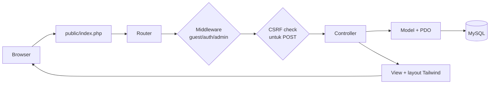

# 01 · Project Scaffolding — Mountrawr

Platform sederhana untuk meminjam/menyewa alat pendakian sesuai kebutuhan dan durasi.

## 1. Tech Stack

| Layer | Pilihan | Catatan |
|---|---|---|
| Backend | PHP ≥ 8.1 (native, tanpa framework) | Autoload PSR-4 buatan sendiri (`bootstrap.php`), tanpa Composer |
| Arsitektur | MVC | Router → Controller → Model → View |
| Frontend | Tailwind CSS | Dev: CDN. Produksi: Tailwind CLI build |
| Database | MySQL 8 / MariaDB 10.6+ | Akses lewat PDO + prepared statement |
| Schema | Migration runner (`php mountrawr migrate`) | Tidak perlu membuat tabel manual |

## 2. Struktur Folder

```
mountrawr/
├── app/
│   ├── Controllers/
│   │   ├── Admin/LoanController.php     # approval, borrowed, konfirmasi return
│   │   ├── AuthController.php           # login, register, logout
│   │   ├── CatalogController.php        # katalog + detail & ketersediaan
│   │   ├── HomeController.php
│   │   └── LoanController.php           # ajukan, status, riwayat, return
│   ├── Core/                            # "mini framework"
│   │   ├── Auth.php  Controller.php  Csrf.php  Database.php  Env.php
│   │   ├── Middleware.php  Migrator.php  Model.php  Router.php  Session.php
│   ├── Models/
│   │   ├── User  Category  Item  Loan  LoanItem  LoanReturn  LoanStatusLog
│   ├── Views/
│   │   ├── layouts/main.php
│   │   ├── auth/  catalog/  loans/  admin/loans/
│   └── helpers.php                      # e(), csrf_field(), base_url(), rupiah() ...
├── config/                              # (disiapkan untuk konfigurasi tambahan)
├── database/
│   ├── migrations/                      # 7 file migration (urut berdasarkan timestamp)
│   └── seeders/DatabaseSeeder.php       # admin, kategori, contoh alat
├── docs/                                # dokumen ini
├── public/                              # document root (index.php, .htaccess, uploads/)
├── routes/web.php                       # definisi semua route
├── storage/logs/
├── bootstrap.php                        # autoload + env + timezone
├── mountrawr                            # CLI (migrate, seed, serve)
├── .env.example
└── .gitignore
```

## 3. Alur Request (MVC)



## 4. Setup Lokal

```bash
# 1. Siapkan environment
cp .env.example .env            # lalu sesuaikan DB_NAME, DB_USER, DB_PASS

# 2. Buat database kosong (sekali saja)
mysql -u root -p -e "CREATE DATABASE mountrawr CHARACTER SET utf8mb4 COLLATE utf8mb4_unicode_ci;"

# 3. Migration + seed
php mountrawr migrate
php mountrawr db:seed

# 4. Jalankan
php mountrawr serve             # http://localhost:8000
```

Akun admin awal (dari seeder): `admin@mountrawr.test` / `admin12345` → **wajib diganti** sebelum produksi.

## 5. Perintah CLI

| Perintah | Fungsi |
|---|---|
| `php mountrawr migrate` | Jalankan migration yang belum pernah dijalankan |
| `php mountrawr migrate:rollback` | Batalkan batch migration terakhir |
| `php mountrawr migrate:fresh` | Drop semua tabel lalu migrate ulang (**hanya dev**) |
| `php mountrawr migrate:status` | Lihat status tiap migration |
| `php mountrawr db:seed` | Isi data awal |
| `php mountrawr serve` | Dev server di port 8000 |

### Menambah migration baru
Buat file `database/migrations/YYYY_MM_DD_NNNNNN_nama.php`:

```php
<?php
return [
    'up'   => ["ALTER TABLE items ADD COLUMN weight_gram INT UNSIGNED NULL"],
    'down' => ["ALTER TABLE items DROP COLUMN weight_gram"],
];
```
Urutan eksekusi mengikuti nama file (alfabetis). Jangan mengubah migration yang sudah dijalankan di environment lain; buat migration baru.

## 6. Konvensi

- **Route**: didaftarkan di `routes/web.php`; handler `[Controller::class, 'method']`; middleware array string (`guest`, `auth`, `admin`).
- **Controller**: tipis — validasi input, panggil Model, render View/redirect.
- **Model**: semua query SQL di sini, selalu prepared statement. Logika state (mis. `Loan::changeStatus`) ada di Model.
- **View**: selalu escape output dengan `e()`; setiap form POST wajib `<?= csrf_field() ?>`.
- **Penamaan**: tabel jamak snake_case (`loan_items`), model tunggal PascalCase (`LoanItem`), kolom snake_case.
- **Waktu**: timezone `Asia/Jakarta`; tanggal peminjaman disimpan sebagai `DATE`, event sebagai `DATETIME`.

## 7. Keamanan (baseline)

- Password: `password_hash()` / `password_verify()`.
- Session: `httponly`, `samesite=Lax`, `session_regenerate_id` saat login/logout.
- CSRF token untuk semua POST (diverifikasi di Router).
- Output di-escape (`e()`), query pakai prepared statement.
- Role dicek di middleware (`admin`), **dan** kepemilikan data dicek di controller (user hanya boleh melihat loan miliknya).
- Rencana tambahan: rate limit login, validasi upload gambar (MIME + ukuran), HTTPS + cookie `secure` di produksi.

## 8. Production Tailwind (opsional)

CDN hanya untuk dev. Untuk produksi:
```bash
npm init -y && npm i -D tailwindcss
npx tailwindcss init
npx tailwindcss -i ./resources/input.css -o ./public/assets/app.css --minify
```
Lalu ganti tag `<script src="https://cdn.tailwindcss.com">` di `layouts/main.php` dengan `<link rel="stylesheet" href="/assets/app.css">`.

## 9. Status Scaffolding

| Bagian | Status |
|---|---|
| Core (router, middleware, CSRF, session, auth, PDO, migrator) | ✅ siap |
| Migration 7 tabel + seeder | ✅ siap |
| Register / Login / Logout | ✅ berfungsi |
| Katalog + detail + cek ketersediaan | ✅ berfungsi |
| `Loan::changeStatus` (state machine + log) | ✅ siap |
| Ajukan, approve, reject, borrowed, return, confirm | 🚧 stub `TODO` (lihat `02-todo-task-breakdown.md`) |

> Catatan: kode belum dijalankan di lingkungan pembuatnya (PHP tidak tersedia). Jalankan `php -l` dan smoke test pertama (`migrate` → `db:seed` → buka `/register`) sebelum melanjutkan.
