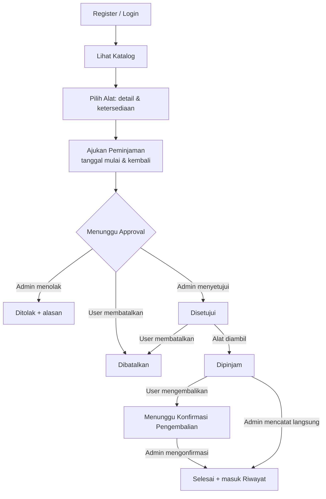
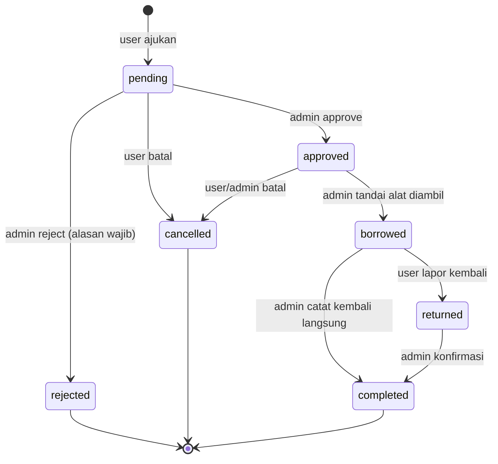

# 03 · Dokumentasi Alur (Flow) — Mountrawr

## 1. Aktor

| Aktor | Role di DB | Kemampuan |
|---|---|---|
| Tamu | — | Melihat katalog & detail, register, login |
| Peminjam | `peminjam` | Ajukan/batalkan peminjaman, lapor pengembalian, lihat status & riwayat sendiri |
| Pemilik / Admin | `admin` | Approve/reject, tandai dipinjam, konfirmasi pengembalian, kelola alat |

> "Pemilik" dipetakan ke role `admin`. Jika kelak ada beberapa pemilik berbeda yang masing-masing punya alat, tambahkan `items.owner_id` (lihat §7 Pengembangan).

## 2. User Flow Utama



## 3. State Machine Status Peminjaman

Nilai di kolom `loans.status`. Perubahan **hanya** lewat `Loan::changeStatus()` yang memvalidasi transisi dan menulis `loan_status_logs`.



| Status | Label UI | Memblokir stok? | Siapa yang memicu |
|---|---|---|---|
| `pending` | Menunggu Approval | Tidak | Peminjam |
| `approved` | Disetujui | **Ya** | Admin |
| `rejected` | Ditolak | Tidak | Admin |
| `cancelled` | Dibatalkan | Tidak | Peminjam / Admin |
| `borrowed` | Dipinjam | **Ya** | Admin |
| `returned` | Menunggu Konfirmasi Pengembalian | **Ya** | Peminjam |
| `completed` | Selesai | Tidak | Admin |

"Terlambat" **bukan** status tersimpan; diturunkan: `status = 'borrowed' AND end_date < CURDATE()`.

## 4. Aturan Ketersediaan

Sisa stok alat `X` pada rentang `[start, end]`:

```
available = items.stock_total
          − SUM(loan_items.quantity)
            untuk loan berstatus ∈ {approved, borrowed, returned}
            yang rentangnya overlap:  loan.start_date <= :end  AND  loan.end_date >= :start
```

- Pengajuan `pending` **tidak** memblokir (agar satu orang tidak mengunci stok tanpa persetujuan), tetapi dicek ulang saat approve.
- Rentang tanggal inklusif (hari mulai dan hari kembali sama-sama dihitung).
- Diimplementasi di `Item::availableStock()`.

**Skenario uji** (stok total = 3):

| # | Data existing | Request | Hasil |
|---|---|---|---|
| 1 | tidak ada | 10–12 Okt, qty 3 | tersedia 3 |
| 2 | approved 10–12 Okt qty 2 | 11–13 Okt | tersedia 1 (overlap) |
| 3 | approved 10–12 Okt qty 2 | 13–15 Okt | tersedia 3 (tidak overlap) |
| 4 | approved 10–12 qty 2 + borrowed 12–14 qty 1 | 12 Okt | tersedia 0 |
| 5 | pending 10–12 qty 3 | 10–12 Okt | tersedia 3 (pending tak memblokir) |
| 6 | cancelled/rejected/completed | apa pun | tidak dihitung |

## 5. Detail Tiap Alur

### 5.1 Register & Login
1. `GET /register` → form. `POST /register`: validasi nama, email (format + unik), password ≥ 8 & cocok konfirmasi.
2. Simpan `users` (`role = peminjam`, password di-hash) → langsung login → redirect `/catalog`.
3. `POST /login`: cari email, `password_verify`. Sukses → `session_regenerate_id`, redirect: admin → `/admin/loans`, peminjam → `/catalog`. Gagal → pesan generik "Email atau password salah".

### 5.2 Katalog → Detail
1. `GET /catalog?category=&q=` → alat aktif + kategori.
2. `GET /catalog/{slug}?start=&end=` → detail + hasil `availableStock` bila tanggal diisi.

### 5.3 Ajukan Peminjaman (login wajib)
1. Input: `start_date`, `end_date`, daftar `items[{item_id, quantity}]`, `note`.
2. Validasi: `start >= today`, `end >= start`, durasi ≤ batas, `quantity ≥ 1`.
3. **Transaksi**: cek `availableStock` tiap item → insert `loans` (status `pending`) → insert `loan_items` (snapshot harga) → hitung `total_price = Σ(price × qty × jumlah_hari)` → log (`null → pending`).
4. Redirect ke `/loans/{id}`.

### 5.4 Approval Admin
1. Admin membuka `/admin/loans?status=pending`.
2. **Approve** (transaksi, lock baris loan): re-check stok seluruh item dengan `excludeLoanId`; bila cukup → `approved`, isi `approved_by`, `approved_at`. Bila tidak → tolak aksi + pesan "stok tidak lagi mencukupi".
3. **Reject**: wajib `rejection_reason` → `rejected`.

### 5.5 Pengambilan Alat
Admin menekan "Tandai Dipinjam" pada loan `approved` → `borrowed`, isi `borrowed_at`.

### 5.6 Pengembalian
1. Peminjam menekan "Kembalikan" (status `borrowed`) → insert `loan_returns` (`returned_at = now`) → status `returned`.
2. Admin memeriksa fisik alat di `/admin/loans/{id}` → mengisi `item_condition`, catatan → sistem menghitung `late_days = max(0, tanggal returned_at − end_date)` dan `penalty_amount` → `completed`, isi `confirmed_by/at`.

### 5.7 Status & Riwayat
- `/loans`: loan aktif (`pending`, `approved`, `borrowed`, `returned`) + timeline log.
- `/loans/history`: `completed`, `rejected`, `cancelled`.
- Halaman detail menampilkan timeline dari `loan_status_logs` (transparansi: siapa mengubah, kapan, catatan).

## 6. Peta Route

| Method | Path | Controller@method | Middleware |
|---|---|---|---|
| GET | `/` | Home@index | — |
| GET/POST | `/login` | Auth@showLogin / login | guest |
| GET/POST | `/register` | Auth@showRegister / register | guest |
| POST | `/logout` | Auth@logout | auth |
| GET | `/catalog` | Catalog@index | — |
| GET | `/catalog/{slug}` | Catalog@show | — |
| GET | `/loans` | Loan@index | auth |
| GET | `/loans/history` | Loan@history | auth |
| POST | `/loans` | Loan@store | auth |
| GET | `/loans/{id}` | Loan@show | auth (+ cek kepemilikan) |
| POST | `/loans/{id}/cancel` | Loan@cancel | auth |
| POST | `/loans/{id}/return` | Loan@returnItem | auth |
| GET | `/admin/loans` | Admin\Loan@index | admin |
| GET | `/admin/loans/{id}` | Admin\Loan@show | admin |
| POST | `/admin/loans/{id}/approve` | Admin\Loan@approve | admin |
| POST | `/admin/loans/{id}/reject` | Admin\Loan@reject | admin |
| POST | `/admin/loans/{id}/borrowed` | Admin\Loan@markBorrowed | admin |
| POST | `/admin/loans/{id}/confirm-return` | Admin\Loan@confirmReturn | admin |

## 7. Pengembangan Lanjut (di luar MVP)
- Multi-pemilik: tambah `items.owner_id` → FK `users.id`; admin hanya mengelola alat miliknya.
- Notifikasi WhatsApp/email, deposit/jaminan, pembayaran online, unit alat individual (serial/QR) menggantikan stok agregat.
